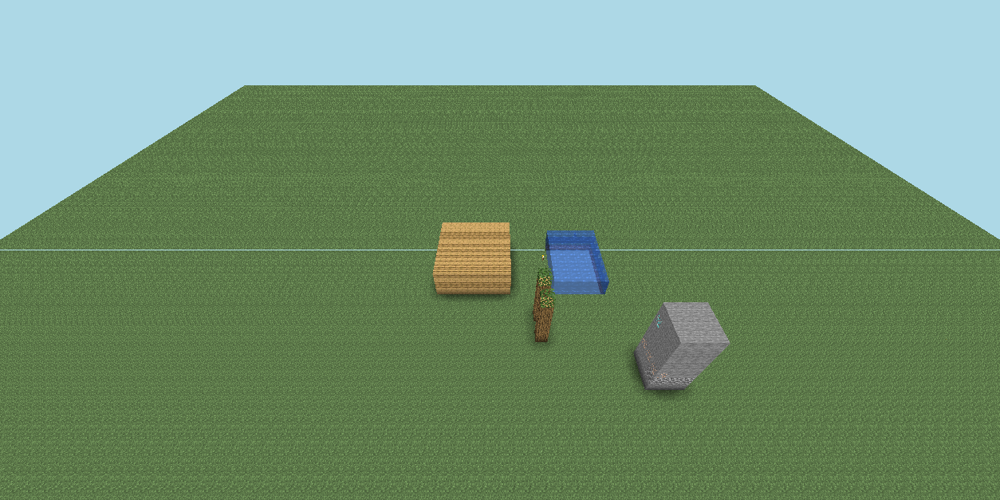

# MC “看屏幕”可行性（MC-EYES）

> 问题：**MC 那块现在能真看屏幕吗？** —— 现在不能直接看：body 用 mineflayer，只拿协议里的世界状态，没有任何渲染。要让模型“看到”MC，需要外挂渲染或结构化快照。
>
> 本文对比三条路线、给出推荐、并附带一个已跑通的 PoC：`packages/mc-body/tools/eyes-poc.mjs`（离线区块 → prismarine-viewer → Edge headless 截图）。下方截图为 PoC 真产物（1280×720 视口，实际画布 1254×627）。



## 0. 结论（TL;DR）

1. **能“真看”，但要外挂渲染**：`prismarine-viewer`（three.js 浏览器渲染）+ **Edge headless（CDP 截图）** 在本机 Windows 已跑通；离线区块演示世界 **7.1s 截到一张 1254×627 / 352KB PNG**，方块/材质/水面可见。**不开 GPU 跑模型的锁**（`--disable-gpu` 走 SwiftShader 软件渲染，耗 CPU）。
2. **推荐分层用眼，而不是一直看**：
   - **默认：结构化快照（方案 C）** —— 用现有 `status/inspect(map/scan/look/inventory)` 生成几 KB 的 JSON 场景描述，便宜、稳定、零依赖，模型能直接推理；
   - **按需：headless 截图（方案 A）** —— 模型/告警/里程碑/早报时截一张，约 7–8s、Edge 峰值约 **1.3GB 私有内存（9 进程）**，用完即关；
   - **补充：用户客户端 F2/OBS（方案 B）** —— 最高保真（真实光影/HUD/皮肤），但需要用户在场，不能 headless 自动化。
3. **不建议长时间连续 1fps 截图**：Edge 固定开销 ~1.3GB + 软件渲染 CPU 争用，会和 lab/E2 抢资源；如需视频，用低频（如 1 帧/2–5s）+ 明确触发窗口，或等机器空闲。
4. **E2 期间只跑离线区块 PoC**：没有启动 MC 服务器、没连 54838、没碰 lab；bot 模式脚本已写但在 E2 结束前未验证。

## 1. 现状与约束

- `mineflayer` 是协议客户端，**无渲染**（不加载 GPU/图形栈），只有方块/实体/背包/位置等结构数据。
- body 已有“结构化眼睛”：`status`（位置/血/饱食/维度/时间/附近 hostile/装备/`playable`/`spawnLog`）、`inspect look/scan/map/inventory`（方块、实体距离+坐标、脚下方块图、背包）。
- 用户客户端（Fabric，本机 54838）才是真正的“屏幕”，但那是用户的窗口，不是 agent 的。
- 本机环境（PoC 实测）：Windows、Node v26.12.1、Edge **156.0.4314.58**、24 核 CPU、47.7GB RAM；npm 可达 registry。

## 2. 三方案对比

| 维度 | A. headless prismarine-viewer + 浏览器截图 | B. 用户客户端 F2 / OBS | C. 结构化场景快照 |
|---|---|---|---|
| 是否真像素 | ✅ 真渲染（方块/材质/水/建筑） | ✅ 最真（光影/HUD/皮肤/粒子） | ❌ 不是像素，是语义 JSON（可再离线渲染） |
| 依赖 | prismarine-viewer + 浏览器（Edge 自带）+ Node CDP | 用户在游戏内；OBS/Game Bar 另装 | 仅 body 现有 HTTP 工具 |
| 资源 | Edge 峰值 ~1.3GB 私有内存（9 进程）；**软件渲染 CPU**（不占 GPU 模型锁）；Node ~108MB | 用用户 GPU/客户端；OBS 额外开销 | ~KB 级、毫秒级 |
| 延迟 | 启动+渲染 ≈ **7s**（可优化 warm 浏览器/复用实例） | 取决于人（秒~分钟） | <100ms（本地 HTTP） |
| 自动化 | ✅ 可脚本/CDP/定时/事件触发 | ❌ 需要人按 F2/开 OBS | ✅ 完全自动 |
| 稳定性 | 中（headless 浏览器、端口、版本、auto-update） | 高（真人看） | 高（现有链路） |
| 能看什么 | 方块世界、地形、建筑、水/岩浆；**看不到 HUD/背包 UI**；默认第三人称 | 全部（第一人称视角、HUD、手持、聊天） | 方块/实体/背包/位置/任务；无视觉风格/氛围 |
| 集成成本 | PoC 已有；产品化需可选依赖 + viewer 端口 + 生命周期 | 无法集成（人工通道） | 低（body 已有，补 schema/触发即可） |
| 结论 | **推荐作为“像素眼”按需使用** | **人工兜底/高保真复核** | **推荐作为默认“语义眼”** |

## 3. 方案 A：headless prismarine-viewer + 截图（已 PoC）

### 3.1 链路

```
世界数据源 ──► prismarine-viewer standalone (express + socket.io + 静态页面)
                    │  http://127.0.0.1:<viewerPort>/
                    ▼
            Edge --headless=new --disable-gpu（WebGL via SwiftShader，CPU）
                    │  CDP: Page.navigate → 等 7s 渲染 → Page.captureScreenshot
                    ▼
            PNG（+ 同名 .json 元数据）→ media/mc-eyes/…（给 album/video/早报）
```

- **不要用 Edge CLI 的 `--screenshot` 直接截 viewer 页面**：实测会截在 socket 区块到达之前（图里只有天空）。必须先 CDP 导航、等真实渲染（PoC 用 7s），再 `Page.captureScreenshot`。
- `--headless=new --disable-gpu` 下 WebGL 走 SwiftShader（软件光栅），已验证可用；**不会占 GPU 跑模型/ComfyUI 的锁**。
- 世界数据源三种：
  1. **离线/内存世界**（PoC 默认）：`prismarine-world`+`prismarine-chunk` 现场生成演示世界，**不需要 MC 服务器**；
  2. **观察 bot**：另起一个 mineflayer bot 连服务器，把 `bot.world` 交给 standalone viewer（截图它周围；会多一个玩家连接）；
  3. **body 内嵌（推荐产品化方向）**：在 body 进程里起 viewer，直接复用 body 的 bot/world，画面即“body 周围/第一人称”。

### 3.2 PoC 实测

| 指标 | 值 |
|---|---|
| 安装 | 独立目录 `npm i prismarine-viewer@1.33.0`：146 包 / 44s（不污染 mc-body 依赖） |
| 离线演示世界 | 32×32 草地 + 木屋 + 水池 + 树 + 矿石柱，viewDistance=3 |
| 截图耗时 | **7.1s**（含 Edge 启动 + 页面加载 + 7s 渲染等待） |
| 产物 | 1280×720 视口 → 画布 1254×627；PNG **352KB**；帧序列 `--frames 2` 已验（静态场景两帧相同，属预期） |
| Node 内存 | viewer 进程 RSS ≈ **108MB** |
| Edge 内存 | 9 进程，私有内存 ≈ **1313MB**，WorkingSet ≈ 1552MB（1280×720 与 960×540 基本相同——**固定开销为主**） |
| 渲染质量 | 方块/材质/水面/树叶可见；远处有摩尔纹/无抗锯齿；**实体/玩家皮肤/名字/HUD 不渲染** |

证据：`docs/assets/mc-eyes-poc.png` + `docs/assets/mc-eyes-poc.json`；本机临时产物在 `.state/lab/mc-eyes-poc/`。

### 3.3 怎么跑（PoC）

```bash
# 1) 一次性安装 viewer（不进产品依赖）
mkdir -p C:/DSH/icl/.state/lab/mc-eyes-poc/viewer
cd C:/DSH/icl/.state/lab/mc-eyes-poc/viewer
npm init -y && npm i prismarine-viewer@1.33.0

# 2) 离线演示世界截一张（不需要 MC 服务器）
cd C:/DSH/icl-wt/mc-body
node packages/mc-body/tools/eyes-poc.mjs \
  --viewer-root C:/DSH/icl/.state/lab/mc-eyes-poc/viewer \
  --width 1280 --height 720 --wait-ms 7000 \
  --out C:/DSH/icl/.state/lab/mc-eyes-poc/shot

# 3) 截帧序列（给 album/video）
node packages/mc-body/tools/eyes-poc.mjs --viewer-root <dir> --frames 5 --interval-ms 1000 --out <base>

# 4) 观察 bot（E2 结束/独立开发服再跑；会多一个连接）
node packages/mc-body/tools/eyes-poc.mjs --mode bot --host 127.0.0.1 --mc-port 54840 \
  --username ICL-eyes --viewer-root <dir> --out <base>
```

产物：`<out>.png`（或 `<out>-f001.png…`）+ `<out>.json`（模式/viewer 版本/视口/中心点/方块数/耗时/sanity/Node RSS 等）。

### 3.4 与 body 的集成方式（产品化建议，本轮不改产品）

- **推荐：body 内嵌 viewer（可选依赖）**。在 mineflayer 适配器 `spawn` 后启动一个 viewer 端口（如 `MC_BODY_VIEWER_PORT=3998`），复用 `bot.world`/`bot.entity`；截图仍由宿主侧 Edge CDP 完成。这样画面就是 body 自身的眼睛（可做第一人称）。
  - 注意：`prismarine-viewer` 的官方 `mineflayer` 导出依赖服务端 `canvas`（实体/名字贴图）；**本机 Node 26 Windows 上 `canvas@3` 预编译缺失、node-gyp 编译失败**（已实测），所以不要直接 `require('prismarine-viewer')`（其 index 会连带加载需 canvas 的 viewer）。
  - 可用路径：直接用 `prismarine-viewer/lib/standalone.js`（不需要 canvas）或自己用 `viewer/lib/worldview` + express/socket.io 写 ~40 行 server；`mineflayer` 插件仅在能装上 canvas 的环境使用。
- **备选：独立观察 bot**：PoC `--mode bot` 已实现（`bot.world` + standalone）；代价是服务器多一个玩家连接，且看到的是观察点而非 body 第一人称；需用不同 username、不与 body 抢动作。
- **离线世界/schematic 预览**：适合“给模型看设计图/施工验收”，不依赖服务器（PoC 默认模式）。

### 3.5 已知限制

- 无 HUD/背包 UI/聊天/准星/粒子；默认第三人称轨道相机（standalone 只发 position，不带 yaw/pitch；第一人称需自定义 server 发 `position {pos,yaw,pitch}`，见 `viewer/lib/index.js` 的 `setFirstPersonCamera` 分支）。
- 只能渲染已加载/已发送的区块；`viewDistance` 越大内存/CPU 越高（PoC 用 3）。
- 实体皮肤/名字不渲染（canvas 缺失路径）；方块材质由 prismarine 资源包近似，版本需与服务器匹配（PoC viewer 支持到 1.21.4）。
- 远处方块有摩尔纹/闪烁，不适合做精细像素判断（用结构化快照或用户截图复核）。

## 4. 方案 B：用户客户端 F2 / OBS（人工兜底）

- **F2**：MC 自带截图到 `%APPDATA%\.minecraft\screenshots\`（Windows），分辨率/光影/皮肤/HUD 全是真实客户端效果；但需要**用户在线且按下 F2**，无法由 agent 自动触发（除非客户端 mod 提供 API）。
- **OBS/Game Bar**：可录屏/推流，质量最高；需要安装/配置、会占 GPU/磁盘，且属于“监视用户屏幕”，需用户明确同意。
- 适用：需要真实视觉判断（建筑美观、红石、UI 状态、光影）、或 PoC 渲染不可信时的人工复核通道。
- 不建议做成默认：不可自动化、隐私/同意成本高、和“agent 自己看”目标不一致。

## 5. 方案 C：结构化场景快照（默认语义眼，建议先做）

不做像素，直接把 body 已有的结构信息组装成稳定的“场景描述”，给模型/album/早报：

```json
{
  "ts": "2026-11-06T11:52:00+08:00",
  "runId": "night-1",
  "position": { "x": 17, "y": 65, "z": -59 },
  "dimension": "overworld",
  "health": 19, "food": 17, "time": { "isNight": false, "clock": "06:49" },
  "held": "stone_pickaxe", "hotbar": ["dirt×6", "crafting_table×1", "…"],
  "look": { "block": "grass_block", "entities": [{ "name": "zombie", "distance": 12.7, "position": { "x": 5, "y": 66, "z": -50 } }] },
  "map8": ["####....", "…"],            // inspect map ±8 的脚下方块图
  "nearbyBlocks": { "oak_log": 4, "stone": 8, "iron_ore": 2 },
  "task": { "state": "running", "kind": "collect", "progress": { "done": 3, "total": 8 } },
  "safety": { "paused": false, "reflex": { "enabled": true, "lastAt": null } },
  "recentEvents": [ { "seq": 123, "type": "task_progress" } ]
}
```

- 成本：几 KB / 毫秒级；完全复用 `status` + `inspect`，无新依赖、无 GPU。
- 用途：模型日常“看场景”、宏任务/长测的 checkpoint、异常取证、早报；也可离线用方案 A 的 viewer 把它渲染成图片（同一世界数据）。
- 局限：没有“画面感”（光影/建筑审美/UI），不能替代像素眼；对远处/大范围结构需要更大 map/scan（或分块快照）。

## 6. 推荐落地顺序

1. **P0（立刻可用，零风险）**：结构化快照（方案 C）作为默认“眼睛”：在 `mcb_status`/checkpoint/告警/早报里附一段 compact JSON（或 text）场景描述；模型按需 `mcb_map/mcb_scan/mcb_look` 细化。
2. **P1（按需像素眼）**：把 `eyes-poc.mjs` 产品化：host 侧在“模型要求/重大里程碑/异常取证/早报配图”时调用一次截图（约 7–8s），写 `media/mc-eyes/<runId>/…`，事件通知 album/video；**不要常驻 1fps**。
3. **P2（视频/直播眼）**：需要连续画面时，用 `--frames` 低频（1 帧/2–5s，限时窗口）或复用同一个 Edge 实例减少启动开销；1fps 连续录制约 350KB/帧 → 10min ≈ 200MB，需保留策略。
4. **P3（body 内嵌）**：在 body 可选依赖里接 prismarine-viewer standalone/WorldView（绕过 canvas 依赖），暴露 `/viewer` 端口与第一人称相机；lab/宿主按需截图。
5. **人工兜底**：用户 F2/OB 作为高保真复核通道，不做默认链路。

## 7. 与 album / video 的接口建议

- 目录：`media/mc-eyes/<runId>/<timestamp>-<kind>.png|.json`（kind: `offline|bot|body|milestone|alert|report`）。
- 元数据（同名 `.json`）：`{ts, runId, mode, position, dimension, viewport, viewerVersion, files, task, safety, note}`；album/video 可直接索引/展示。
- 事件：`mc_eyes {files, meta, reason}`（quiet，不叫醒；除非作为告警取证）。
- 帧序列：`<base>-f001.png…` + 一条 meta；video eyes 可按帧合成/抽帧。
- 保留：默认只存“里程碑/告警/早报”截图；连续帧设 TTL/上限（如 ≤50 帧或 ≤100MB），避免磁盘膨胀。

## 8. 风险清单

| 风险 | 实测/评估 | 缓解 |
|---|---|---|
| Edge 固定内存开销 | 9 进程私有 ≈1.3GB（与视口基本无关） | 用完即关；同一实例复用；只在触发时启动；低内存机器不启用 |
| CPU 争用 | SwiftShader 软件渲染（不占 GPU 锁），渲染 + 页面加载会占 CPU 数秒 | 与 lab/E2 错峰；低分辨率；限频；捕获完立刻 kill 进程树 |
| headless 浏览器漂移 | Edge auto-update/端口/首启策略变化 | 固定 `--user-data-dir`、显式 `--edge-path`、失败回退结构化快照 |
| 版本/材质不匹配 | viewer 支持版本有限；材质近似 | 用 `bot.version` 或已知服务器版本；不用于精细像素判断 |
| canvas 原生依赖 | Node 26 Windows 上 `canvas@3` 编译失败（实测 gyp 错） | 不用官方 `mineflayer` 导出；用 standalone/自写 WorldView server |
| 相机限制 | standalone 默认第三人称、固定 center；无 HUD | P1 只做周边截图；第一人称需自写 server 发 yaw/pitch |
| 实体/皮肤缺失 | 需 canvas | 明示“看不到皮肤/名字；玩家位置可用结构化数据补” |
| 端口冲突 | viewer/debug 端口需可配 | `--port` / `--debug-port`；先探测/失败重试 |
| CDP 安全 | 仅 127.0.0.1、调试端口暴露 | 绑定回环、随机端口、捕获后关浏览器；不要把 debug 端口暴露公网 |
| 隐私/同意 | 用户客户端截图涉及用户屏幕 | 仅用户明确同意时走 F2/OBS；agent 侧用自渲染画面 |
| 与长测抢资源 | E2 期间起浏览器会占 CPU/内存 | PoC 仅离线跑；产品化加资源门控（lab 空闲/用户触发） |

## 9. 待验证（E2 结束后）

- `--mode bot` 连独立开发服（54840/normal）截一张真实地形；验证 `bot.world` → standalone 的区块/材质质量。
- body 内嵌 viewer（WorldView + 自定义 socket server，绕过 canvas）与第一人称相机；`/viewer` 生命周期/端口/关闭。
- 视频序列：复用 Edge 实例、低帧率、编码（现有 video 管线）与 album 接口。
- 与用户客户端 F2 同场景对比（保真差异、方块颜色/光影偏差）。
- 资源门控：与 lab/E2 的 CPU/内存互斥策略（例如同一时间只允许一个 capture）。

## 10. P0/P1 实现状态与接口（2026-11-06）

### 10.1 P0 结构化快照（已实现，零依赖）

- **body 端点**：`GET /v1/eyes/snapshot?radius=8` → `{ok, snapshot, captureMs}`。
  - `snapshot` 字段：`position/dimension/health/food/oxygen/time/held/hotbar/inventory{items,counts,emptySlots}/equipment/lookingAt/map(脚下方块图 ±radius)/nearbyBlocks/entities/nearbyHostiles/spawnSafety/task/queue/safety{paused,reflex,lastReflex,alarms}/playable/recentEvents`。
  - 数据源：adapter 新 `snapshot()`（直接读 bot：方块网格、实体坐标、背包/快捷栏/手持、时间/维度/威胁/安全）＋ body `status()`；adapter 不可用时降级到 status+inspect。暂停/离线也能出基础快照。
- **成本**：毫秒级、几 KB、无浏览器/GPU；**日常看场景先用它**。
- 代码：`packages/mc-body/src/eyes.mjs` `buildStructuredSnapshot`；adapter `snapshot()`；测试 `test/eyes.test.mjs` + body 测试。

### 10.2 P1 按需截图（已实现，需可选 viewer + Edge）

- **body 端点**：`POST /v1/eyes/screenshot`
  ```json
  { "kind": "milestone|alert|manual|…", "width": 1280, "height": 720,
    "waitMs": 7000, "frames": 1, "intervalMs": 1000, "portStart": 3998 }
  ```
  → `{ok, outBase, files:[{file,bytes,at}], meta, captureMs}`；同名 `.json` meta 落盘。
- **流程**：ack → adapter `startScreenshotViewer()`（用 `bot.world` + 当前 pose 起 **可关闭** viewer，端口 3998 起自增）→ `captureScreenshot`（Edge headless CDP：导航→等 waitMs→`Page.captureScreenshot`→写 PNG→**kill Edge 进程树**）→ `stopScreenshotViewer()` 关 viewer。任一步失败也清理。
- **配额/风控**：同一时刻只允许 1 个截图；两次截图最小间隔 `eyesMinIntervalMs=15s`；`frames` 1–8、间隔 ≥1000ms（默认 1 帧，默认关闭）；`waitMs` 3–10s；超限 429，缺 viewer/Edge 501，失败 500 带原因。
- **存储**：默认 `media/mc-eyes/<runId>/<ts>-<kind>.png|.json`（`--media-dir` / `MC_BODY_MEDIA_DIR`、`--run-id` / `MC_RUN_ID` 可覆盖；`media/` 已 gitignore）。
- **配置**：`MC_EYES_VIEWER_ROOT`（装 prismarine-viewer 的目录，必需）、`MC_EYES_EDGE`（可选，默认找 Edge）；CLI `--media-dir --run-id --eyes-port`。
- **成本**：约 7–8s/张；Edge 峰值 ~1.3GB 私有内存（软件渲染，不占 GPU 模型锁）；用完即关。
- **真产物**：P0/P1 共享代码已用离线世界验证：viewer 起服务 + CDP 截图 **7.1s / 998×483 / 267KB**（`.state/lab/mc-eyes-poc/p1-tool.png`）；工具 `eyes-poc.mjs` 已改为复用同一份 `src/eyes.mjs`。
- **未验证**：body 端点真服 happy-path（需要 MC 服务器；E2 期间不启动）——E2 结束后用独立开发服跑 `--mode bot` 与 `/v1/eyes/screenshot`。

### 10.3 mc-link 工具面（待 mc-link 接）

- `mcb_snapshot {radius?}` → `GET /v1/eyes/snapshot`（text 摘要 + JSON；描述写"日常看场景先用它，别一上来截图"）。
- `mcb_eyes {mode:'structured'|'screenshot', kind?, frames?}`：
  - structured = 同上；
  - screenshot → `POST /v1/eyes/screenshot`，把 `files[0].file` 作为图片附件给模型（旧宿主 text-only 回退给路径 + meta 摘要）；描述写清成本（~7–8s、Edge ~1.3GB、仅里程碑/告警/明确要求时用）与 quota。
- mc-link 需对 screenshot 结果做附件/路径双形态；P2 帧序列复用 `frames` 参数（默认 1）。
